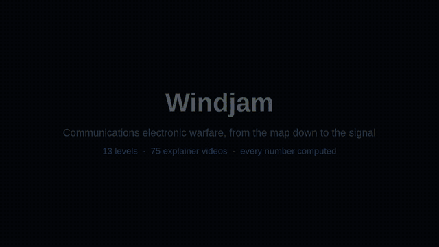
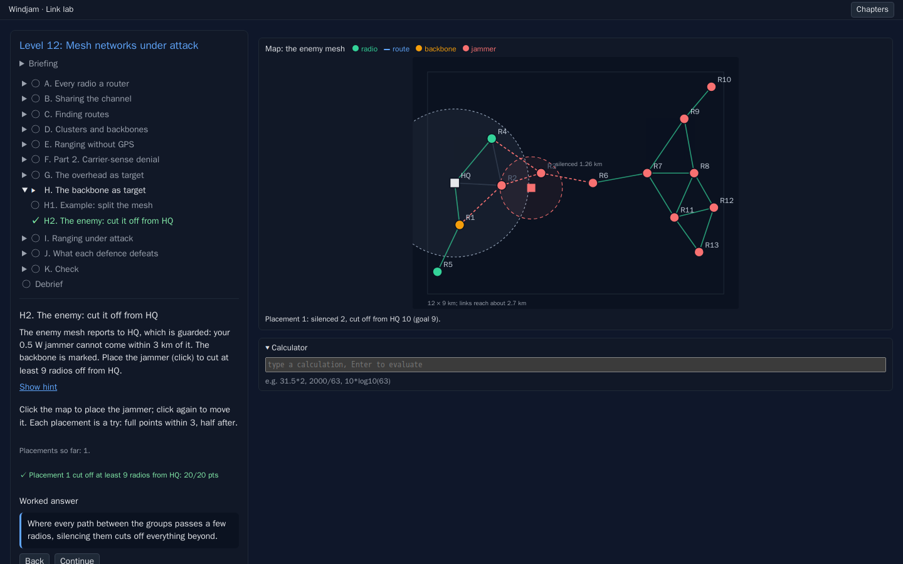
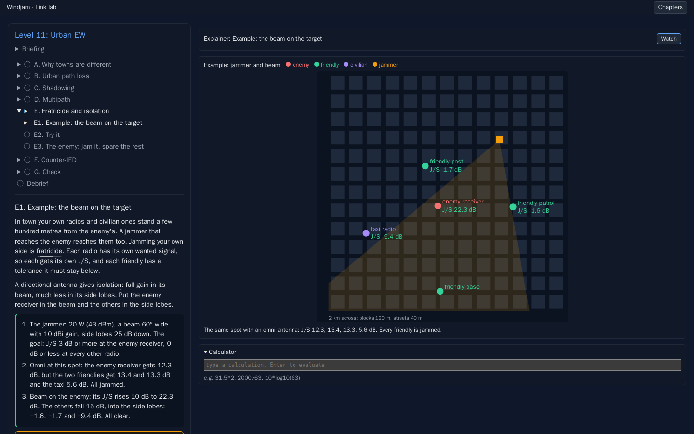
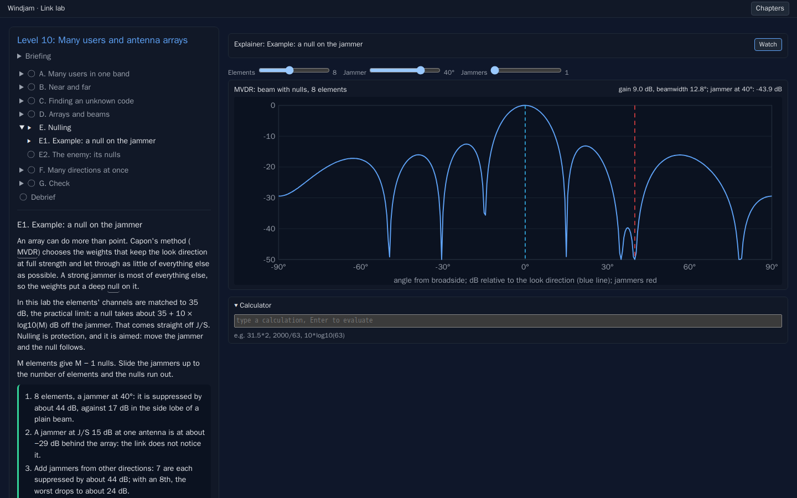
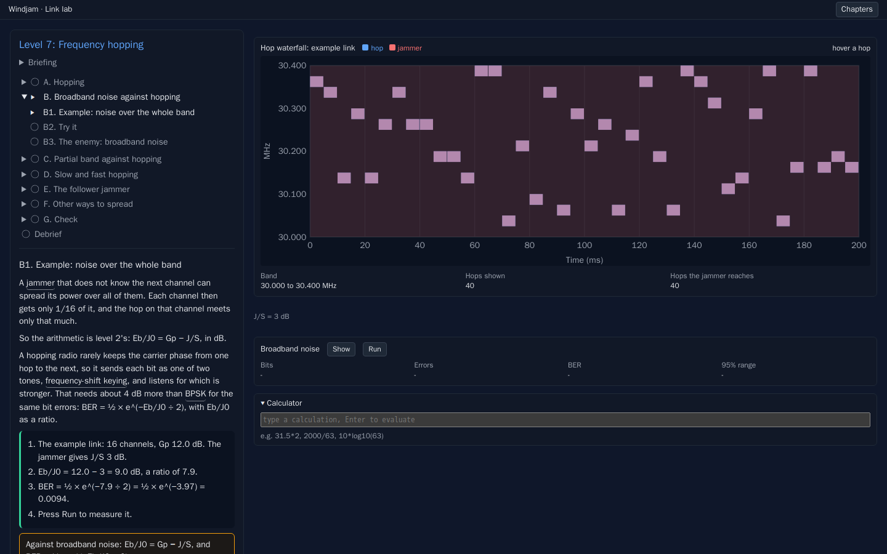
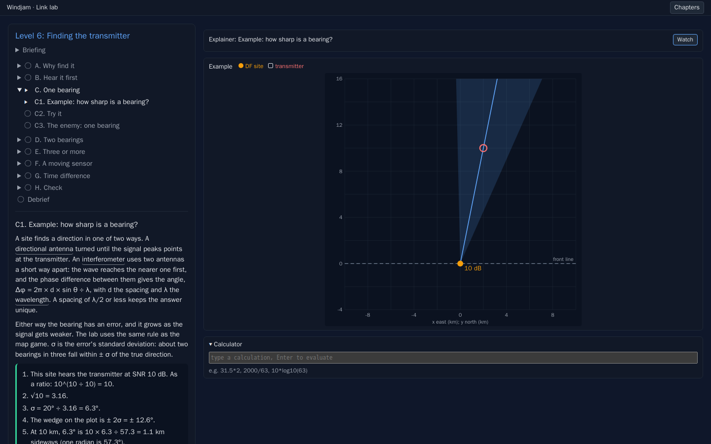
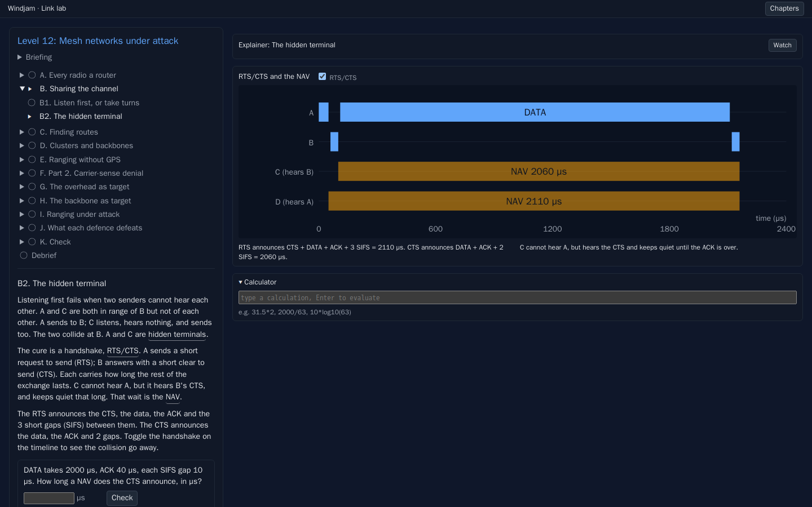
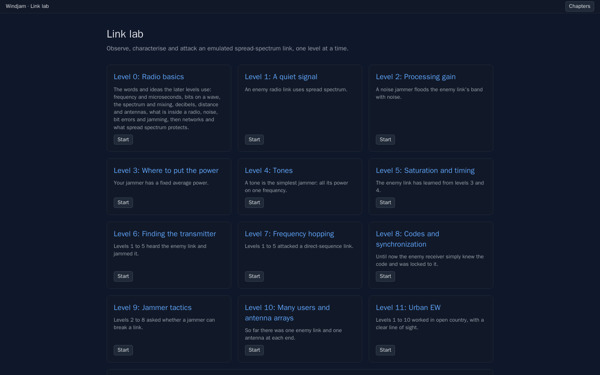
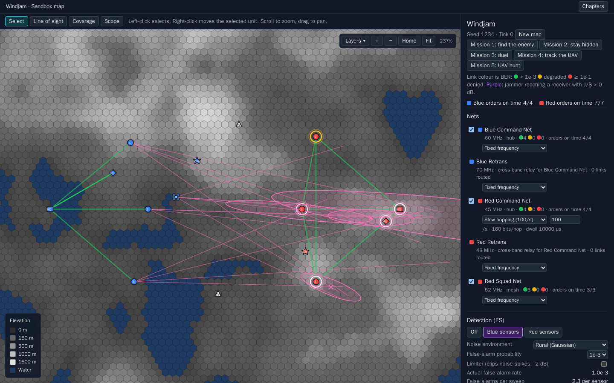

<div align="center">

# Windjam

**Communications electronic warfare, from the map down to the signal.**

Find a radio link, measure it, jam it, locate its transmitter, and see why each attack works or fails.
Every number on screen is computed by the engine, and the lessons' numbers are checked against it by tests.

[](docs/assets/windjam-tour.mp4)

**13 levels** · **200 steps** · **75 explainer videos** · **132 glossary terms** · **896 tests**

</div>

---

## What it is

Windjam is a browser simulation with three chapters:

| Chapter | What you do |
|---|---|
| **Link lab** | A guided course in 13 levels. Each level teaches one idea with a worked example and a short video, lets you practise it, then gives you an enemy link to attack, scored out of 100. |
| **Sandbox map** | A 128 × 69 km hex world with two sides, radio nets over real terrain, nine jammer modes, detection and direction finding, and a scope. |
| **Missions** | Five missions against a hidden enemy, played at a console, from a loaded script, by two people at one screen, or by AI agents through a game server. |

Everything runs in the browser. Nothing is scripted: a link turns red because its bit error rate crossed a threshold, a fix lands where the bearings cross, and a mesh splits because the jammer silenced the radios that held it together.

## Watch the tour

<!-- GitLab plays the video inline; other hosts show a link. -->


## The Link lab

Each level follows the same pattern: a **worked example** with the sums laid out, **practice** with a fresh problem each time, then **the enemy**: a seeded task that only counts when you get it right. A calculator, a glossary on every marked term and a short Manim video sit beside each lesson.

| Level | Title | You learn to |
|---|---|---|
| 0 | Radio basics | Read the words the rest uses: frequency, dB, path loss, noise, BER, J/S, networks, and what spread spectrum protects (LPD, LPI, LPE, AJ) |
| 1 | A quiet signal | Find a direct-sequence link below the noise and measure its chip rate, code length and processing gain |
| 2 | Processing gain | Turn J/S into Eb/J0 and BER, and break the link with broadband noise |
| 3 | Where to put the power | See why partial-band noise gains nothing against DSSS while pulses at the best duty do |
| 4 | Tones | Jam with a tone against long and short codes, and push a front end over with multitone peaks |
| 5 | Saturation and timing | Beat a repetition vote with pulses on whole bits, and blind a receiver's front end |
| 6 | Finding the transmitter | Take bearings, fix the transmitter by least squares, read the error ellipse and CEP, use a moving sensor and TDOA |
| 7 | Frequency hopping | Read a hop set from a waterfall, jam part of the band, race a follower jammer against the dwell |
| 8 | Codes and synchronization | Rebuild an m-sequence from its chips, acquire and track a code, and jam the preamble instead of the data |
| 9 | Jammer tactics | Budget platform power and battery, use distance over power, share one jammer across targets, cut a hub off |
| 10 | Many users and antenna arrays | Separate CDMA users, cancel a near-far user, find an unknown code blind, steer a beam, null a jammer, run MUSIC |
| 11 | Urban EW | Plan J/S with Hata loss and shadowing margins, read bearings bent off walls, place and point a jammer that spares friendly radios |
| 12 | Mesh networks under attack | Learn how a MANET relays, shares the channel and routes, then silence it by carrier sense, split it at its backbone, spoof its ranging and drain its batteries |

Level 0 and the first part of level 12 are lessons only. Every other level is scored out of 100 with a pass mark of 60, and every enemy is drawn from a fresh seed.

### From the lab

| | |
|---|---|
|  |  |
| **Level 12.** Place a 0.5 W jammer to cut the enemy mesh off from its HQ. The backbone shows where the paths converge. | **Level 11.** A directional jammer gives 22.3 dB on the enemy receiver and keeps every friendly radio below 0 dB. |
|  |  |
| **Level 10.** An adaptive array keeps its beam on the link and puts a 44 dB null on the jammer. Slide the jammer and the null follows. | **Level 7.** A hopping link on its waterfall, and what spreading the jammer over 16 channels leaves of it. |
|  |  |
| **Level 6.** A bearing, its ± 2σ wedge, and how SNR sets the error. | **Level 12.** The hidden terminal, and how RTS/CTS keeps a neighbour quiet. |



## The sandbox map and missions



Two sides, Blue and Red, each with an HQ, squads, a relay and an EW team on a seeded terrain map. Links are analysed over the terrain profile with two-ray loss and knife-edge diffraction. Nets can be fixed-frequency, hopping or direct sequence. Jammers can be spot, barrage, partial-band, multitone, pulse, swept, follower or sync. Squads and a drone detect emitters and take bearings that become fixes with error ellipses. Orders are scored on whether they arrive in time.

Five missions build on it, from finding a hidden enemy to a UAV hunt between two AI agents over HTTP. A replay with an inspector shows how each fix and each denied link came to be, minute by minute, with links to the lesson that teaches the sum. Eighteen scenarios, from a one-person fox hunt to taking down an air-defence net's links, play themselves to the end for the inspector. The full reference, from propagation to the game server, is in **[docs/sandbox.md](docs/sandbox.md)**.

## Run it

Requires Node 22.

```bash
npm install
npm run dev        # http://localhost:5173
npm test           # every engine and UI test
npm run build      # typecheck and production build
```

Open a chapter directly with `?chapter=lab`, `?chapter=sandbox` or `?chapter=missions`, and a level with `?chapter=lab&level=12`.

The lesson videos are in Git LFS (`git lfs install`, then `git lfs pull`). To render one again from its Manim scene, see [videos/README.md](videos/README.md):

```bash
npm run video -- level12-H1             # review copy in tmp/videos/
npm run video -- level12-H1 --publish   # also public/videos/
```

## How it is built

```
src/engine/          pure TypeScript: no DOM, deterministic, seeded
  rf.ts, budget.ts     propagation, link budgets, noise
  ew.ts, detect.ts     jamming, detection, direction finding
  lab/                 the Link lab's engine
    dsss.ts, fh.ts       spread-spectrum and hopping links, sample by sample
    pn.ts, sync.ts       codes, acquisition, tracking
    geoloc.ts            bearings, fixes, TDOA
    tactics.ts           platforms, power, sharing, networks
    array.ts, cdma.ts    beams, nulls, MUSIC, multiple users
    urban.ts, mesh.ts    town propagation, meshes and their attacks
    levels/              one file per level: text, truths, checks, scoring
src/ui/              React panels, instruments and a Pixi.js map that read the engine
videos/              Manim scenes; numbers exported from the engine
docs/                design notes, one per level, and the curriculum
```

- **One engine, many readers.** The map, the lab's instruments, the lesson videos and the tests all read the same functions, so a figure in a video is the figure in the app.
- **Checked numbers.** The level tests check the numbers the lessons quote against the engine, so text and engine cannot drift apart.
- **Sources corrected, not copied.** Each design note ends with the errors found in its source material and what the lab teaches instead. See [docs/design-curriculum.md](docs/design-curriculum.md).
- **Stack.** TypeScript, React 19, Pixi.js 8, Vite, Vitest, Manim.

## Design notes

| Note | Covers |
|---|---|
| [design-curriculum.md](docs/design-curriculum.md) | The 13 levels, where each source went, the ideas that connect levels, corrections |
| [design-link-lab.md](docs/design-link-lab.md) | The lab itself: chapters, the emulated link, levels 1 to 5 |
| [design-level-0.md](docs/design-level-0.md), [design-level-6.md](docs/design-level-6.md) to [design-level-12.md](docs/design-level-12.md) | One note per level from 6 on, and level 0: decisions, units, scoring, videos, corrections |
| [design-lesson-videos.md](docs/design-lesson-videos.md) | How the explainer videos are made |
| [design-hierarchical-agents.md](docs/design-hierarchical-agents.md) | Planned: a commander and unit agents per side |

## License

MIT. See [LICENSE](LICENSE).
